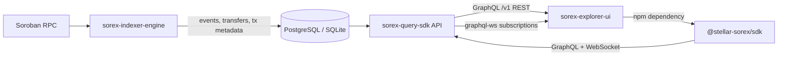

# sorex-query-sdk

GraphQL + REST query API and the published `@stellar-sorex/sdk` client for
[Soroban](https://soroban.stellar.org/) events indexed by
[`sorex-indexer-engine`](https://github.com/Stellar-Sorex/sorex-indexer-engine).

[](https://github.com/Stellar-Sorex/sorex-query-sdk/actions/workflows/ci.yml)
[](LICENSE)
[](https://www.npmjs.com/package/@stellar-sorex/sdk)

The API is read-only. It reads the indexer schema directly and does not mutate
indexed data.

## Architecture



| Package | Purpose |
| --- | --- |
| `packages/api` | Fastify server: GraphQL (Mercurius), REST + OpenAPI at `/docs`, graphql-ws subscriptions, rate limiting, LRU/Redis caching. |
| `packages/sdk` | `@stellar-sorex/sdk`: typed browser/Node client with zod-validated responses and live subscriptions. |

## Quickstart

Requires Node.js 22+ and an indexer database.

```bash
git clone https://github.com/Stellar-Sorex/sorex-query-sdk
cd sorex-query-sdk
npm ci
cp packages/api/.env.example packages/api/.env
# point DATABASE_URL at the same database used by sorex-indexer-engine
npm run dev
```

- GraphQL + GraphiQL: <http://localhost:4000/graphql>
- REST docs: <http://localhost:4000/docs>
- OpenAPI JSON: <http://localhost:4000/openapi.json>
- Health: <http://localhost:4000/health>
- Metrics: <http://localhost:4000/metrics>

The API creates its own migration table (`sorex_query_migrations`) and uses
`CREATE TABLE IF NOT EXISTS`, so it can safely read an existing indexer database.

## REST

| Method | Path | Description |
| --- | --- | --- |
| GET | `/v1/events` | Filter by `contractId`, `topic0`–`topic3`, `ledgerFrom`, `ledgerTo`, `txHash`, `type`, `eventName`, `timeFrom`, `timeTo`; `limit`, `cursor`, `order`. |
| GET | `/v1/events/:id` | Event plus normalised transfer, when applicable. |
| GET | `/v1/contracts/:contractId` | Contract stats, event-name counts, recent events and transfers. |
| GET | `/v1/contracts/:contractId/events` | Contract event stream with the same filters. |
| GET | `/v1/token-transfers` | SEP-41 transfers by `contractId`, `from`, `to`, `asset`. |
| GET | `/v1/transactions/:txHash` | Transaction fee/resource metadata and all events in the transaction. |
| GET | `/v1/ledgers/:sequence` | Per-ledger counts and fees charged. |
| GET | `/v1/search?q=` | Contract ID, transaction hash, ledger sequence or event ID. |
| GET | `/v1/health` | Index freshness and API health. |

Paginated responses are `{ "nodes": [...], "pageInfo": { "endCursor", "hasNextPage" } }`.

```bash
curl 'http://localhost:4000/v1/events?eventName=transfer&limit=2&order=desc'
curl 'http://localhost:4000/v1/contracts/CDLZ...'
```

## GraphQL

```graphql
query RecentTransfers {
  events(first: 10, eventName: "transfer") {
    nodes {
      id
      contractId
      ledger
      topicsJson
      dataJson
      transfer {
        amount
        asset
        from
        to
      }
    }
    pageInfo {
      endCursor
      hasNextPage
    }
  }
}
```

```graphql
subscription LiveEvents($contractId: String) {
  events(contractId: $contractId) {
    id
    ledger
    eventName
    topicsJson
  }
}
```

Subscriptions use the `graphql-transport-ws` protocol. The server normally
receives live events from a PostgreSQL `LISTEN/NOTIFY` trigger and always runs a
polling fallback (also used on SQLite).

## SDK

```bash
npm install @stellar-sorex/sdk
```

```ts
import { SorexClient } from "@stellar-sorex/sdk";

const client = new SorexClient({
  url: "http://localhost:4000",
  // apiKey: "optional-key",
});

const page = await client.events.list({
  contractId: "CDLZFC3SYJYDZT7K67VZ75HPJVIEUVNIXF47ZG2FB2RMQQVU2HHGCYSC",
  eventName: "transfer",
  first: 20,
});

for (const event of page.nodes) {
  console.log(event.ledger, event.topicsJson, event.transfer?.amount);
}

const stop = client.events.subscribe(
  { contractId: "CDLZFC3SYJYDZT7K67VZ75HPJVIEUVNIXF47ZG2FB2RMQQVU2HHGCYSC" },
  {
    onEvent: (event) => console.log("live", event.id),
    onError: (error) => console.error(error.code, error.message),
  },
);

// later
stop();
```

Other methods:

```ts
await client.events.get(eventId);
await client.tokens.transfers({ from: "G..." });
await client.contracts.get(contractId);
await client.transactions.get(txHash);
await client.ledgers.get(5670000);
await client.health();
```

Responses are validated with zod and exposed as TypeScript types
(`SorexEvent`, `SorexTokenTransfer`, …). Errors are `SorexApiError` with
`code`, `status` and optional `details`.

## Configuration

| Variable | Default | Description |
| --- | --- | --- |
| `PORT` | `4000` | HTTP port. |
| `HOST` | `0.0.0.0` | Bind address. |
| `DATABASE_URL` | `sqlite:./data/sorex-read.db` | PostgreSQL URL or `sqlite:path`. |
| `STORAGE_DRIVER` | inferred from URL | `postgres` or `sqlite`. |
| `REDIS_URL` | – | Optional Redis for shared response caching. |
| `CORS_ORIGIN` | `*` | Comma-separated allowed origins, or `*`. |
| `RATE_LIMIT_MAX` | `120` | Requests per window per IP/API key. |
| `RATE_LIMIT_WINDOW` | `1 minute` | Rate-limit window. |
| `MAX_PAGE_SIZE` | `100` | Hard page-size cap. |
| `CACHE_TTL_MS` | `5000` | Hot-query cache TTL; `0` disables caching. |
| `CACHE_MAX_ITEMS` | `500` | LRU capacity. |
| `QUERY_DEPTH_LIMIT` | `8` | GraphQL selection depth cap. |
| `QUERY_COMPLEXITY_LIMIT` | `300` | Maximum selected fields per document. |
| `SUBSCRIPTION_POLL_MS` | `1000` | Polling interval for subscription feed. |
| `METRICS_ENABLED` | `true` | Expose Prometheus `/metrics`. |
| `NETWORK` | `testnet` | Label in health responses (`testnet`, `mainnet`, …). |
| `LOG_LEVEL` | `info` | pino level. |

## Development

```bash
npm ci
npm run typecheck
npm run lint
npm test
npm run test:coverage
npm run build
npm run changeset
```

- API tests use an in-memory SQLite database seeded with realistic events and
  cover REST, GraphQL, subscriptions, pagination, OpenAPI and rate limiting.
- SDK tests run against a local mock GraphQL + graphql-ws server.
- Coverage thresholds: 70% lines/statements/functions, 60% branches.

## Limitations

- Read-only: writes belong to `sorex-indexer-engine`.
- Public RPC does not expose historical Soroban memory usage; `memoryBytes` is
  `null` rather than a fabricated value. CPU/read/write values are declared
  envelope limits.
- Subscription fan-out is in-process. Run one API instance or share Redis plus
  sticky sessions when scaling horizontally.
- SQLite is intended for local development, not concurrent production traffic.

## License

Apache-2.0. See [LICENSE](LICENSE).
